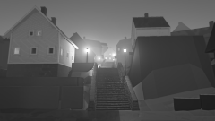
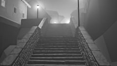
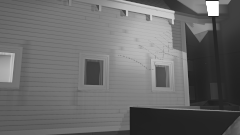
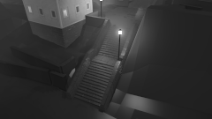

# The walked corner: art direction

Øystein, 27 October: "I want you to have more of a designers eye. Make our style and art truly outstanding." This page sets how the corner's four judged views are designed in each light; the frames in `frames/` show it, and every later element is judged against them. The masters it draws on are in [masters.md](masters.md).

**In short**
- **One picture, three parts.** Every view is a dark near curtain (retaining walls, the rock knuckle, the wet ground), a lit middle where the focus is (the Landing and C's corner), and a glimpse beyond (the gully's top in its own air). Nothing in the curtain is lighter than the middle.
- **One key, one accent.** Each light has one key colour in every shade and one accent: the lanterns' gold in blue hour, D's wet pantiles in drizzle (C's door is out of the street cameras' sight), the sun's gold on C's front in low sun. One white and the largest halo are at the focus; every other lamp sits two values under it with a third of its halo, and lit fog stays below the focus's wall.
- **Value before colour.** Each frame is a value study at 1/8 first (`-eighth.png`, five values in `-values.png`); colour comes only after the values read.
- **Found at the focus, lost elsewhere.** Crisp edges and full detail only at the focus and where a lit plane meets the sky; creases inside a dark mass are lost; past 50 m only shapes and lights remain.
- **Facts stand.** The three gully lanterns are drawn at their planned places (every 24 m, the lowest on the cheek wall; the layout drops them today); the Landing's 1955 lantern replaces its clay stand-in; no person is drawn. Reopens if a frame needs a house, step, lamp or person the facts lack: then the facts change first, in the engine.

## The views

| View | Focus and eye travel | Value plan (blue hour, 1/8) |
| --- | --- | --- |
| **Street camera** (`street`) | The Landing lantern by C's warm-lit corner. In by the wet steps' ladder of light, up to the Landing, out to the lit fog at the gully's top; the cheek-wall lantern, centre-right, held two values under the Landing's. |  |
| **Foot of the steps** (`eye-foot`) | The Landing lantern and C's lit corner above the flight; the treads' wet noses lead straight up to it, the two far lanterns and the fog beyond. |  |
| **A house front at eye level** (`c-east`) | C's east wall in the Landing lantern's light: the boards, the windows and the paint's age at full truth, the lantern's post the one dark vertical. |  |
| **12 m** (`into12`) | The Landing seen from above: C's lit plinth corner, the lantern, the flight turning up the gully; the knuckle a dark wedge at the right. |  |

Street and the foot of the steps have judged frames; the house front and 12 m have value plans only.

**Colour script.** The same for every view; what changes is where the focus falls.

| Light | Key (every shade) | The one accent | Warmest | Darkest |
| --- | --- | --- | --- | --- |
| **Blue hour in sea fog** (17:50) | Blue-violet of the fogged sky; white walls pale blue-violet, still the lightest built mass | The lanterns' gold; the one white is the nearest lantern's glass | The lit fog over the gully's top, peach | The near retaining wall's foot and the rock knuckle |
| **Drizzle** (13:00) | Silver-grey of a bright overcast; sky lightest, then puddles that mirror it, wet treads, C's wall; walls cool blue-grey | D's wet pantiles, dull burnt orange, darker than its wall | D's pantiles; wet rock and plinths a warm brown-grey | C's nearest window glass and the near wall's foot |
| **Low sun** (16:00) | The sun's gold on what faces it against the sky's blue in every shade: two values more than five | The gold on C's sunlit front at the Landing | C's sunlit front | The near wall in shade and the shadow under C's eaves |

## The corner's shapes

- **Roofs:** one simple plane each against the sky, steep gables read as triangles; the silhouette is the roof's whole statement at the street stop. Slate (C) dark and cool, pantile (D, E) warm, both darker than their walls in every light.
- **Chimneys:** small dark verticals that punctuate the ridges; among the few crisp darks against the sky.
- **Walls:** a pale painted body on a dark stone plinth, so each house is two values. Clapboard lines show only near and at the focus; beyond 30 m a wall is one value with its windows.
- **Steps:** a ladder of thin light lines (the wet tread noses) between two dark cheek walls: the corner's leading line, kept crisp to the Landing.
- **Ground:** a dark wet plane that doubles the lights, broken into patches; never a pale even field.
- **The rock knuckle:** one dark mass, its silhouette kept and its facets lost, lit only in a small warm patch by its lantern.
- **Growth and trees:** the only soft, irregular shapes besides the fog: they break the clay's straight tops (the knuckle, the wall copings) and frame the gully; dark against the sky, a lit edge where a lamp or the sun reaches them.

**Edges and detail.** Most detail and the hardest edges at the focus (the lantern, C's corner, the treads near the Landing) and where a lit plane meets the sky; stone courses near; past 50 m only shapes, window lights and roofs; past 130 m silhouettes and lights in the air. Inside a dark mass, edges are lost.

## The frames and how they are made

`frames/<view>-<moment>.png` with `-grey`, `-eighth` and `-values`, made by `tools/style_frame.py <view> <moment>` from the recipe [frames.json](frames.json) (every value, hue, mass, lamp and edge is data there). It paints over `LT1Houses.Still`'s render (`render/`) and `LT1ArtPasses`' passes (`passes/`: normal, distance, class, surface kind), both rebuilt in Unity and not tracked.
